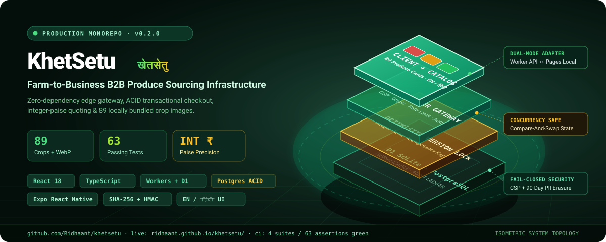
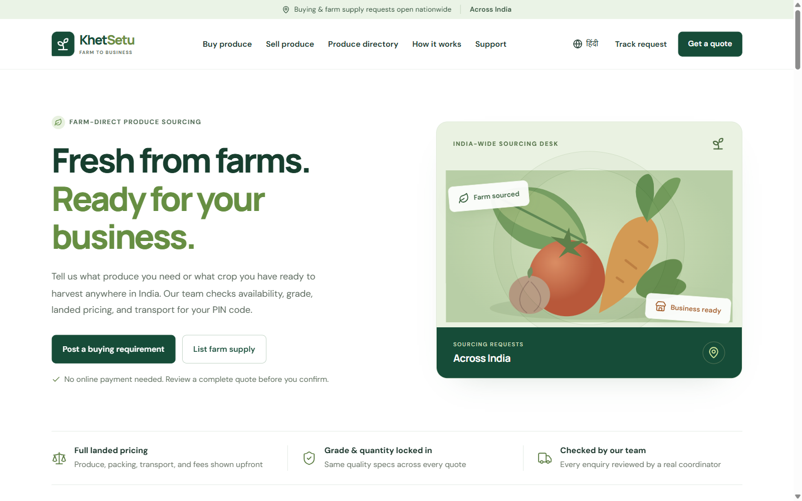
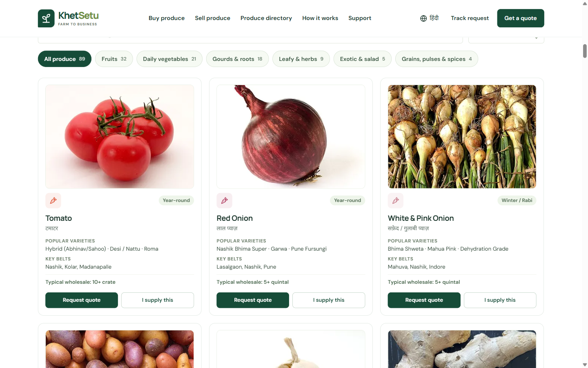
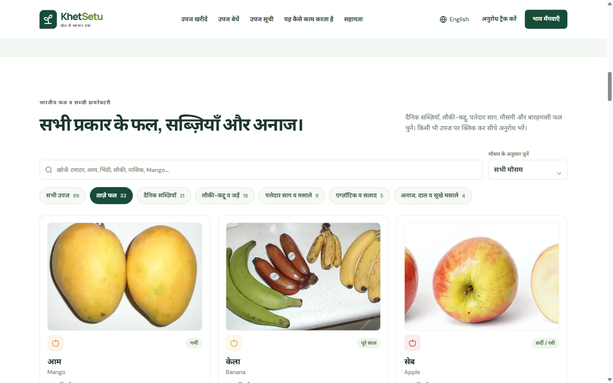
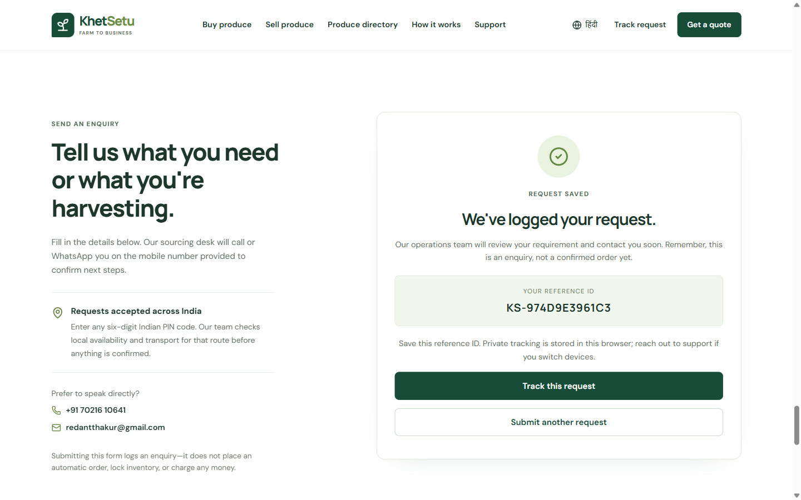
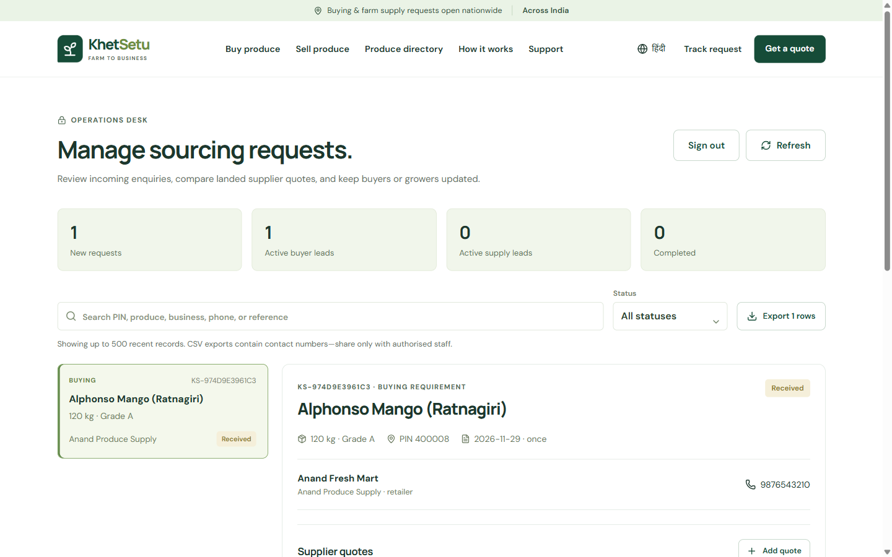
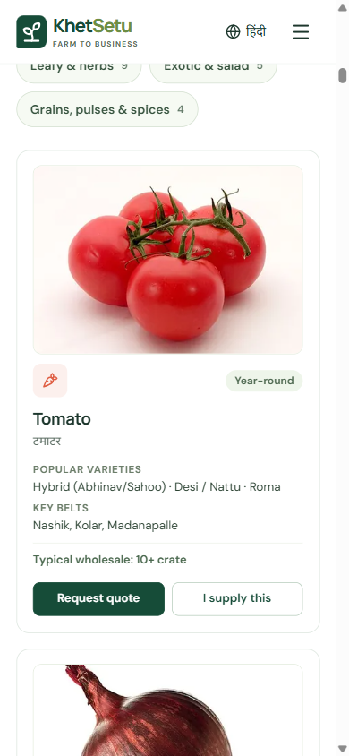
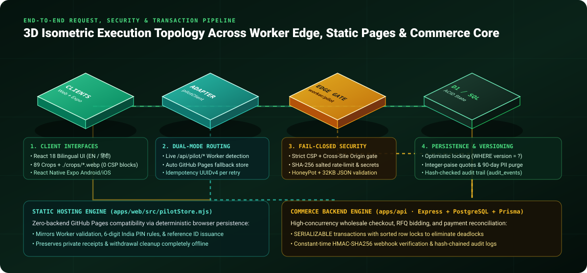

<p align="center">
  
</p>

<h1 align="center">KhetSetu (खेतसेतु)</h1>

<p align="center">
  <strong>Bilingual, security-hardened B2B agricultural sourcing platform connecting Indian growers and FPOs directly with commercial buyers.</strong>
</p>

<p align="center">
  <a href="https://ridhaant.github.io/khetsetu/">
    
  </a>
  <a href="https://github.com/Ridhaant/khetsetu/actions">
    
  </a>
  
  
</p>

<p align="center">
  <a href="https://ridhaant.github.io/khetsetu/">View Live Application</a> ·
  <a href="#architecture--engineering-deep-dive">3D System Architecture</a> ·
  <a href="#live-ui-walkthrough">UI Screenshots</a> ·
  <a href="#program-structure">Program Structure</a> ·
  <a href="#quick-start--verification">Quick Start</a>
</p>

---

## Executive Overview

Indian fresh produce wholesale suffers from fragmented communication, hidden middleman commissions, floating-point rounding drift across unit conversions, and oversold inventory during simultaneous checkouts. **KhetSetu** ("Field Bridge") solves this with a production-grade monorepo engineered across three runtime surfaces:

1. **Bilingual Assisted Sourcing Platform (`apps/web` + `worker/`):** Instant English/Hindi switching across an **89-crop directory** with verified produce photography, nationwide 6-digit Indian PIN code capture, idempotent request intake, SHA-256 secret-protected private tracking receipts, and an authenticated Coordinator Operations Desk issuing **integer-paise landed quotes**.
2. **Zero-Backend Static Hosting Fallback (`pilotClient.ts` + `pilotStore.mjs`):** Automatically detects when no `/api/pilot/*` Cloudflare Worker is mounted (such as on GitHub Pages at [`https://ridhaant.github.io/khetsetu/`](https://ridhaant.github.io/khetsetu/)) and delegates seamlessly to an API-compatible browser persistence layer without breaking validation, receipts, quotes, or Hindi flows.
3. **ACID Transactional Commerce Engine & Native App (`apps/api` + `apps/mobile`):** Express REST service backed by **PostgreSQL `SERIALIZABLE` transactions** with sorted row-lock ordering to eliminate deadlocks, raw-body **HMAC-SHA256 webhook verification**, hash-chained audit events, and an Expo React Native mobile client.

---

## Live UI Walkthrough

All screenshots below were captured directly from live Playwright runs against the built application (`1440×900` desktop & `390×844` mobile, zero console errors, zero broken images across all 89 crops).

<table>
  <tr>
    <td width="50%" valign="top">
      <a href="docs/screenshots/hero-en.png"></a>
      <br />
      <strong>1. Buyer &amp; Grower Entry Hero</strong>
      <br />
      <sub>Clear two-sided entry points for commercial buyers and FPOs/growers with upfront pricing &amp; quality guarantees.</sub>
    </td>
    <td width="50%" valign="top">
      <a href="docs/screenshots/produce-catalogue.png"></a>
      <br />
      <strong>2. 89-Crop Produce Directory (Locally Bundled WebP)</strong>
      <br />
      <sub>Every crop displays a locally bundled <code>400×280</code> <code>.webp</code> image, regional origin belts, Indian varieties, seasonal badges, and direct quote pre-fill.</sub>
    </td>
  </tr>
  <tr>
    <td width="50%" valign="top">
      <a href="docs/screenshots/produce-fruits-hindi.png"></a>
      <br />
      <strong>3. Complete Hindi Localization (हिंदी)</strong>
      <br />
      <sub>Full linguistic parity across navigation, multi-faceted group/season filters, crop taxonomy, and enquiry forms for farmers and mandi traders.</sub>
    </td>
    <td width="50%" valign="top">
      <a href="docs/screenshots/request-receipt.png"></a>
      <br />
      <strong>4. Idempotent Intake &amp; Private Tracking Receipt</strong>
      <br />
      <sub>Nationwide 6-digit PIN intake issues an immediate <code>KS-*</code> tracking reference plus a hashed per-device secret token—without disclosing buyer phone numbers publicly.</sub>
    </td>
  </tr>
  <tr>
    <td width="50%" valign="top">
      <a href="docs/screenshots/operations-desk.png"></a>
      <br />
      <strong>5. Coordinator Operations Desk &amp; Landed Quoting</strong>
      <br />
      <sub>Allowlisted operator view with live request pipeline metrics, PIN/phone/reference search, CSV export, status workflows, and optimistic version-locked quotes.</sub>
    </td>
    <td width="50%" valign="top">
      <p align="center"><a href="docs/screenshots/mobile-catalogue.png"></a></p>
      <strong>6. Mobile Responsive Layout (390×844)</strong>
      <br />
      <sub>Zero horizontal overflow across filter chips, dual-action crop cards, and bilingual controls on handheld viewports.</sub>
    </td>
  </tr>
</table>

---

## Architecture & Engineering Deep Dive

<p align="center">
  
</p>

### Key Systems Engineering Highlights

- **Single-Origin Asset Bundling Under Strict CSP (`worker/index.mjs`, `scripts/build.mjs`)**
  The edge Worker serves every document under `img-src 'self' data:` and `object-src 'none'`. All **89 produce `.webp` photos** (~2.2 MB combined) are pre-cropped to `400×280`, bundled into `apps/web/dist/crops/*.webp`, and embedded directly as base64 assets inside `dist/server/index.js` (`~2.37 MB` gzipped, `94` bundled assets total), eliminating third-party hotlink breakage and CSP violations.
- **Optimistic Concurrency & Integer-Paise Accounting (`worker/pilot.mjs`)**
  Status transitions and landed quote confirmations enforce compare-and-swap guards (`WHERE id = ? AND version = ?`) on Cloudflare D1 / Node SQLite (`worker/test/sqlite-d1.mjs`) so concurrent operator updates fail cleanly with `409 Conflict` instead of overwriting state. Every money component (`cropRate`, `transport`, `packaging`) is calculated strictly in **integer paise** (`Math.round`), eliminating IEEE-754 floating-point penny drift.
- **Zero-Trust Input Gate & Privacy Architecture (`worker/pilot.mjs`)**
  All mutations require same-origin headers, reject non-JSON payloads or bodies exceeding `32 KB`, validate honeypot spam fields, apply SHA-256 salted per-IP rate limiting (allowing safe idempotent retries using `idempotency_key` + `payload_hash` verification), require SHA-256 hashed bearer secrets for private receipts, and support **one-click withdrawal erasure plus 90-day PII anonymization** (`scrubExpiredPersonalData`).
- **ACID Commerce Backend & Deadlock-Free Locking (`apps/api/src/`)**
  Retained marketplace checkout orchestrates multi-seller cart splitting with per-listing stock reservations, bulk MOQ/tier pricing boundaries, hash-chained audit trails (`audit_events`), constant-time `crypto.timingSafeEqual` verification over raw HMAC-SHA256 webhook bytes (`payments.ts`), and `SERIALIZABLE` PostgreSQL transactions with sorted lock ordering (`postgres-repository.ts`) to prevent lock-order deadlocks.

---

## Program Structure

```text
khetsetu/
├── .github/workflows/
│   ├── ci.yml                     # CI matrix: schema parity, build, typecheck, lint & all 4 test suites (63 tests)
│   └── pages.yml                  # Automated Vite production build (./ relative base) & GitHub Pages deployment
├── apps/
│   ├── web/                       # React 18 + TypeScript + Vite SPA
│   │   ├── public/crops/*.webp    # 89 locally cropped (400×280) verified Indian crop images
│   │   ├── src/
│   │   │   ├── PilotApp.tsx       # Bilingual EN/HI sourcing platform, directory filters, forms & Ops desk
│   │   │   ├── produceCatalog.mjs # Structured 89-crop catalogue (32 fruits, 21 daily veg, 18 gourds/roots, 9 leafy, 5 exotic, 4 staples)
│   │   │   ├── pilotClient.ts     # Dual-mode HTTP/Static adapter auto-switching Worker <-> browser store
│   │   │   ├── pilotStore.mjs     # LocalStorage-backed static GitHub Pages runtime matching Worker contracts
│   │   │   ├── pilotCopy.ts       # Full English & Hindi translation tables + helper formatters
│   │   │   ├── domain.mjs         # Shared PIN validation, bulk tier pricing, multi-seller cart grouping & INR paise formatting
│   │   │   └── pilot.css          # Responsive typography, botanical design tokens & crop grid styles
│   │   └── test/                  # 12 automated tests covering catalog assets, domain rules & static store
│   ├── api/                       # Express + TypeScript + Prisma + PostgreSQL REST commerce engine
│   │   ├── prisma/                # Declarative schema, immutable initial migration & seed definitions
│   │   ├── src/
│   │   │   ├── app.ts             # REST router, RBAC middleware, Zod-free strict input validation & error envelope
│   │   │   ├── marketplace.ts     # Async lock chain, idempotent multi-seller checkout, RFQ bidding & hash-chained audit
│   │   │   ├── postgres-repository.ts # SERIALIZABLE transactions with deterministic sorted row locks
│   │   │   ├── payments.ts        # Fail-closed Razorpay integration & timing-safe raw HMAC webhook verifier
│   │   │   ├── serviceability.ts  # Policy engine supporting national PIN formats or curated logistics overrides
│   │   │   └── seed.ts            # 56 distinct produce listings with verified Wikimedia Commons photos
│   │   └── test/                  # 22 unit + real HTTP integration tests
│   └── mobile/                    # Expo / React Native iOS & Android client
│       ├── src/                   # Offline-tolerant cache, i18n, assisted sourcing flow & 20-crop seed catalogue
│       └── tests/                 # 9 automated domain, retry-fingerprint & storage resilience tests
├── worker/                        # Cloudflare Worker edge gateway + local SQLite compatibility shim
│   ├── index.mjs                  # Static asset bundler + strict fail-closed security & CSP headers
│   ├── pilot.mjs                  # D1 SQL API, SHA-256 auth/secrets, optimistic version locking & 90-day PII retention
│   └── test/
│       ├── pilot.test.mjs         # 20 concurrency, idempotency, security, rate-limit, quoting & retention tests
│       └── sqlite-d1.mjs          # Node native SQLite adapter emulating Cloudflare D1 prepare/batch semantics locally
├── packages/contracts/            # Shared TypeScript domain contracts across web, api & mobile
├── db/ & drizzle/                 # Authoritative D1 SQLite schema & verified immutable SQL migrations
├── scripts/
│   ├── build.mjs                  # Typecheck -> Vite production build -> single-bundle Worker packer (94 embedded assets)
│   ├── check.mjs                  # Static AST/syntax & unsafe-pattern scanner across web modules
│   ├── generate-pilot-migration.mjs # Verifies db/pilot-schema.sql matches drizzle/0000_assisted_pilot.sql byte-for-byte
│   └── pilot-preview.mjs          # Local HTTP loopback server wrapping built Worker + SQLite + /__local/signin
└── docs/
    ├── assets/                    # Animated 3D isometric SVGs (khetsetu-3d-hero.svg, architecture-3d.svg)
    ├── screenshots/               # Verified Playwright UI captures embedded in this README
    └── *.md                       # Architecture, PRD, Operations, Compliance & Verification logs
```

---

## Produce Catalogue Coverage (89 Verified Crops)

| Category | Count | Sample Crops Included |
| --- | ---: | --- |
| **Fresh Fruits (`ताज़े फल`)** | **32** | Alphonso & Kesar Mango, Banana, Shimla Apple, Bhagwa Pomegranate, Grapes, Papaya, Guava, Nagpur Orange, Kinnow, Mosambi, Lemon, Watermelon, Muskmelon, Pineapple, Chikoo, Litchi, Strawberry, Sitaphal, Pear, Peach/Plum, Dragon Fruit, Kiwi, Avocado, Jackfruit, Jamun, Amla, Ber, Tamarind, Tender Coconut, Fig, Bael |
| **Daily Vegetables (`दैनिक सब्ज़ियाँ`)** | **21** | Tomato, Red Onion, White/Pink Onion, Jyoti Potato, Garlic, Ginger, Green Chilli, Capsicum, Cauliflower, Cabbage, Green Peas, Okra (Bhindi), Brinjal, Drumstick, French Beans, Sem Phali, Guar Phali, Cowpea (Lobia), Sweet Corn, Raw Banana, Raw Jackfruit |
| **Gourds & Roots (`लौकी-कद्दू व जड़ें`)** | **18** | Bottle Gourd (Lauki), Bitter Gourd (Karela), Ridge Gourd (Turai), Sponge Gourd (Gilki), Pointed Gourd (Parwal), Ivy Gourd (Tendli), Apple Gourd (Tinda), Ash Gourd, Snake Gourd, Pumpkin, Cucumber, Carrot, Radish (Mooli), Beetroot, Sweet Potato, Arbi (Taro), Turnip, Suran (Yam) |
| **Leafy & Culinary Herbs (`पत्तेदार साग व मसाले`)** | **9** | Palak (Spinach), Methi (Fenugreek), Coriander (Dhania), Mint (Pudina), Curry Leaves, Sarson (Mustard Greens), Chaulai (Amaranth), Bathua, Spring Onion |
| **Exotic & Salad (`एग्ज़ॉटिक व सलाद`)** | **5** | Broccoli, Iceberg/Romaine Lettuce, Zucchini, Asparagus, Button Mushroom |
| **Grains, Pulses & Dry Spices (`अनाज, दाल व सूखे मसाले`)** | **4** | Indrayani & Basmati Rice, Toor & Moong Dal, Whole/Ground Turmeric, Dry Red Chillies & Whole Spices |
| **Total Directory Coverage** | **89** | **89 cropped `400×280` `.webp` photos locally bundled for Web (`0` broken links) + verified Wikimedia Commons photos in API (`56`) & Mobile (`20`)** |

---

## Quick Start & Verification

### Prerequisites

- **Node.js 22.13+** (uses built-in `node:sqlite` for local Worker SQLite testing and `--experimental-strip-types` / `--experimental-transform-types` for zero-transpile TypeScript execution)

### Local Development

```bash
# 1. Install root & workspace dependencies
npm install
npm --prefix apps/web install
npm --prefix apps/api install

# 2. Build the production SPA + bundle Worker assets, then launch local preview (127.0.0.1:4173)
npm run build
npm run dev
```

Once running locally:
- **Web Platform:** `http://127.0.0.1:4173/`
- **Local Operator Sign-In (Development Only):** `http://127.0.0.1:4173/__local/signin` (redirects to `#operations`)

### Full Verification Suite (`63` Automated Tests)

Run all quality gates in sequence (mirrored identically in [`.github/workflows/ci.yml`](.github/workflows/ci.yml)):

```bash
npm run db:generate               # Ensures db/pilot-schema.sql === drizzle/0000_assisted_pilot.sql
npm run build                     # Builds Vite web bundle & packs dist/server/index.js (94 assets)
npm run typecheck                 # Strict TypeScript check across apps/web (0 errors)
npm run lint                      # Syntax & unsafe-pattern audit across 14 web modules
npm run pilot:test                # 20 Worker/SQLite concurrency, idempotency, security & quote tests
npm test                          # 12 Web domain, static store & 89-crop asset existence tests
npm --prefix apps/api run build   # Transpiles/verifies API TypeScript modules
npm --prefix apps/api run lint    # Syntax & unsafe-pattern audit across 10 API modules
npm run api:test                  # 22 API HTTP integration, HMAC webhook, RBAC & PIN policy tests
npm --prefix apps/mobile test     # 9 React Native offline domain & retry fingerprint tests
```

---

## Deployment & Implementation Boundaries

- **GitHub Pages (Live Static Hosting):** Deployed automatically via [`.github/workflows/pages.yml`](.github/workflows/pages.yml) to [`https://ridhaant.github.io/khetsetu/`](https://ridhaant.github.io/khetsetu/) using Vite's relative `base: './'`. Requests persist locally in the user's browser via `pilotStore.mjs`.
- **Cloudflare Workers + D1 (`wrangler.toml`):** Ready for persistent multi-user deployment with D1 SQL storage (`worker/pilot.mjs`) and operator email allowlisting.
- **Honest Verification Scope:** All 63 automated tests, strict typechecks, lint audits, production builds, and Playwright Chromium checks pass without mocks weakening core business assertions. As documented honestly in [`docs/VERIFICATION.md`](docs/VERIFICATION.md), unmounted external integrations (live Docker PostgreSQL `SERIALIZABLE` DB runs, signed mobile `.apk`/`.ipa` native builds, and live Razorpay sandbox webhooks) remain cleanly isolated behind interface adapters and fail closed when credentials are omitted.

---

<p align="center">
  <sub>Built with craft for transparent Indian agriculture · See <a href="docs/ARCHITECTURE.md">ARCHITECTURE.md</a> &amp; <a href="docs/VERIFICATION.md">VERIFICATION.md</a> for full technical audit logs.</sub>
</p>
