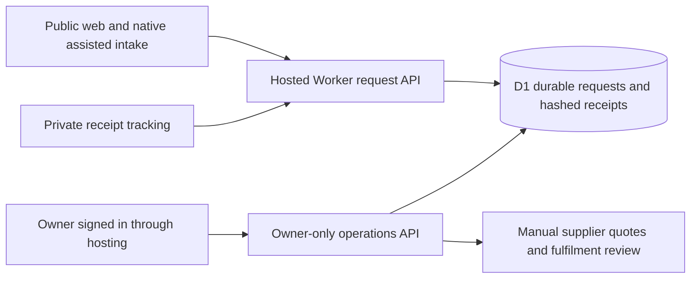
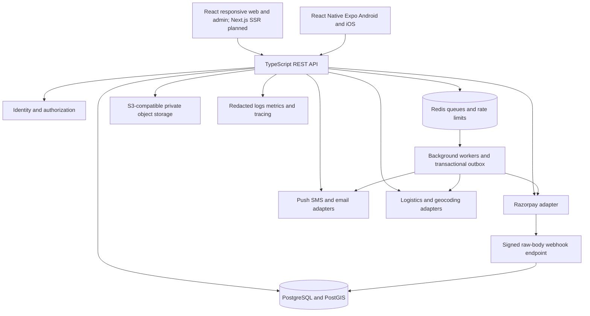
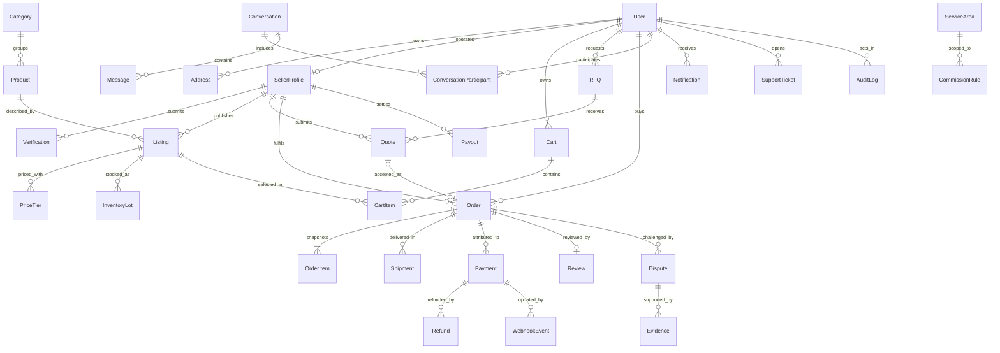

# KhetSetu architecture and data model

## Implementation boundary

Scope revision: 25 November 2026. The current hosted release is a **Worker/D1 assisted sourcing application**. It stores buyer requirements and farmer availability, issues hashed private receipt credentials, supports private tracking/withdrawal and protects operational quotation/status actions through the existing owner identity gate. Web and native assisted-intake source share `/api/pilot`; see [Pilot API](PILOT-API.md). It does not run the older Node checkout service.

Nationwide intake accepts correctly formatted Indian PINs and records origin/destination details for manual feasibility review. Mumbai `400008` is a default example, not an allowlist. Intake eligibility does not assert that the PIN exists, that the produce can travel safely or that a seller/carrier covers the route. Real commerce requires an authoritative exact service-area and provider/seller coverage decision, with state-specific readiness gates.

The retained Node development API uses an explicit `DEMO_MODE=true` in-memory store with seeded role sessions. Its state resets when the process restarts. Serialized access in that process is useful for workflow tests but is not a substitute for PostgreSQL locking, durable idempotency or multi-instance safety. Its formatted-PIN demo eligibility is separate from the hosted Worker and from real delivery coverage.

The Prisma/PostgreSQL schema, migration and repository direction are included for future transactional commerce. Wiring and verifying every production repository operation, identity integration, deployment, backup restore and provider integration are release gates. Historical static-preview/demo test reports remain historical; they do not describe the current hosted D1 persistence or prove a PostgreSQL deployment.

The delivered web client uses **React, TypeScript and Vite**, rather than the requested Next.js default. The package registry was unavailable and Next.js was absent from the local cache; cached React/TypeScript/Vite dependencies made a runnable build possible. This is a documented implementation deviation. Server-rendered product pages, route-based SEO metadata, sitemap generation and structured product data remain a Next.js migration or equivalent server-rendering work item. The backend uses Node.js 24 HTTP modules with a structured TypeScript domain; it is not a NestJS deployment.

## Future transactional topology

Keep pricing, eligibility, inventory, checkout, status transitions, refunds and review rules in backend modules. Web and mobile share request/response schemas and formatting conventions, not duplicated transactional business logic.

The monorepo contains `apps/web`, `apps/api`, `apps/mobile`, `packages/contracts`, `infra` and `docs`. Each application has its own commands and environment configuration. Never place provider secrets in a `NEXT_PUBLIC_*` or `EXPO_PUBLIC_*` variable; those values are shipped to clients.

## Domain modules

| Module | Responsibility | Boundary |
| --- | --- | --- |
| Identity | OTP, sessions, roles and revocation | Provider-backed identity required for production |
| Sellers | Profile, evidence, verification and staff ownership | Private verification files; decisions require reasons |
| Catalogue | Categories, varieties, grades, units and listings | Versionable configuration, soft archival |
| Inventory | Lots, reservations, adjustments and expiry | Database transactions; no client-side stock authority |
| Commerce | Cart revalidation, order snapshots and seller grouping | Money in integer paise; quantity precision explicit |
| Payments | Provider order, signature verification and reconciliation | Gateway is authority for money movement |
| RFQ | Buyer requirements, quotations and acceptance | Atomic one-time acceptance and inventory reservation |
| Fulfilment | Acceptance, packing, dispatch, proof and timeline | Role/ownership and legal transition checks |
| Trust | Reviews, disputes, evidence and moderation | Verified completed order for reviews |
| Operations | Service areas, fees, reports and audit | Least privilege; critical decisions append-only |

## Entity relationships

This ER diagram describes the production domain. The migration and generated Prisma client are the executable source of schema truth; not every diagram entity necessarily has an implemented endpoint in the initial build.

`OrderItem` snapshots must remain usable if a listing is later paused, edited or archived. Audit and financial records should use referential restrictions/soft deletion rather than destructive cascade deletion.

## Transaction contracts

### Checkout

1. Authenticate the buyer; validate and normalise the request; scope the idempotency key to buyer and operation.
2. Load a stored response for the same key and request digest. Return a conflict for a different payload using that key.
3. Start a database transaction. Revalidate address PIN, seller eligibility, listing state/expiry, quantity, unit, MOQ, tier and fee/tax rules.
4. Lock affected inventory rows in a consistent order, or use conditional atomic updates with `available >= required`. Check every affected-row count. A contention failure retries the whole transaction with a bounded policy.
5. Create a checkout group, one order per seller, immutable item/buyer/seller/delivery snapshots and reservations with expiration. Store the idempotency result in the same transaction.
6. Create/recover the provider order through an idempotent adapter. An external request cannot be made atomic with a database transaction; model pending provider creation explicitly and reconcile safely after a timeout.
7. Return only the provider public checkout fields. Do not mark the order paid from the browser callback.

### Payment event

Verify signature over the original raw body with the correct webhook secret before parsing trusted fields. Deduplicate by provider/event identity, then correlate provider order, expected amount and INR currency. Accept only legal state transitions; retain unrecognised or out-of-order events for reconciliation. A captured event commits payment and reservation consumption once. A late capture after reservation expiry needs an explicit paid-but-unfulfillable exception/refund path; it must not oversell silently.

Use constant-time comparison for signatures. Do not log signatures, secrets, card data or full personal addresses. Do not reuse the API key secret and webhook secret interchangeably.

### Cancellation and refunds

Unpaid cancellation releases stock once. A paid order stores the decision and a pending provider refund request; it becomes refunded only after provider confirmation/reconciliation. Unique operation keys prevent duplicate submissions. Keep refund attribution by seller order and item/fee/tax component. Record partial outcomes and failed retries without erasing history.

### RFQ acceptance

Check buyer ownership, RFQ status, quotation validity/expiry, quoted destination and quantity. Lock the RFQ and required inventory, create one order and mark the chosen quote accepted atomically. Competing acceptances must return the already accepted result or a conflict, never create another order.

## Money, units and geography

Store INR amounts as integer paise and tax/commission inputs as explicit rates with controlled rounding. Define whether rounding happens per line or total and preserve the resulting components in order snapshots. Never calculate authoritative totals using floating-point browser values.

Use decimal quantities with per-unit precision. Define conversions in a versioned unit table. Mass/volume/count are distinct dimensions; do not convert litres to kilograms or an unspecified crate to kilograms. The assisted release uses PIN-format validation for nationwide intake and manual route review. Future checkout must validate exact configured buyer service areas, eligible seller routes and provider coverage server-side; absent or unknown coverage fails closed for ordering while an assisted enquiry can remain available. PostGIS can support distance and polygon eligibility later without replacing the authoritative coverage decision.

## Integration contracts

| Adapter | Minimum contract | Missing configuration |
| --- | --- | --- |
| OTP/SMS | Send challenge; verify expiry/attempts; delivery status | Production login unavailable; no universal demo code |
| Razorpay | Create order, verify signed events, fetch status, request/fetch refund | Return explicit unavailable status; no simulated capture |
| Object storage | Presign bounded upload; verify type/size; scan; issue private read URL | Evidence upload unavailable, no public fallback |
| Notifications | Enqueue deduplicated template with preference/consent checks | In-app pending state; no false delivered notification |
| Logistics | Serviceability, quote, assign, track and proof reference | Pilot manual assignment with human timestamps/proof |
| Maps | Optional coarse geocode/distance | Manual PIN/address ordering remains supported |

For the retained Node service, the OpenAPI file in `apps/api` describes routes under `/api/v1`; it is separate from the hosted `/api/pilot` contract. The Node development server binds to loopback, so native LAN/device access to that service needs an intentional host/network configuration change. Version breaking changes under an explicit API version. Return a stable machine-readable error code, safe message, field issues where relevant and request ID. Pagination and scalable search/filter allowlists remain production-path work where not implemented in the demo.

## Security and reliability review

Production controls include HTTPS, CORS allowlist, bounded request bodies, schema validation, rate limits, short-lived access tokens, rotated/revocable refresh sessions, browser CSRF controls where cookie sessions are used, owner checks and least-privilege administration. Scope upload grants; scan before serving; enforce private storage. Use transactional outbox jobs for side effects, exponential retry and dead-letter review.

Database uniqueness protects idempotency and provider event identity across processes. Reservation release and reconciliation workers need distributed coordination or durable claim semantics. Redis alone must not be the ledger for money or inventory. Run PostgreSQL integration tests with concurrent transactions and restart/crash recovery before enabling multi-instance API deployments.
