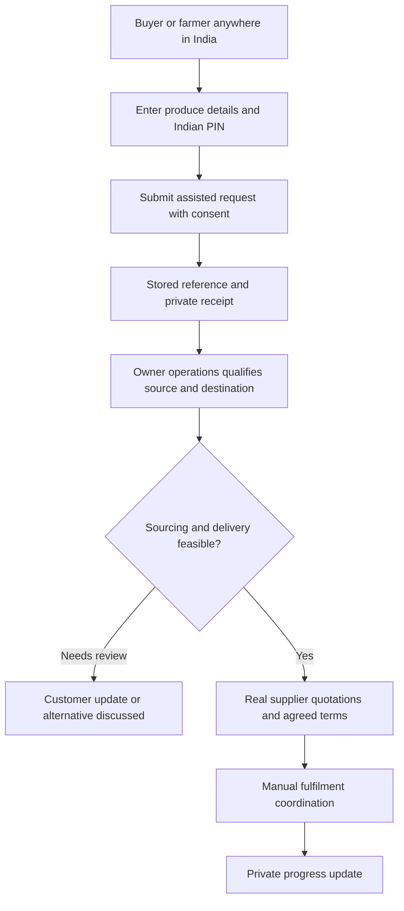
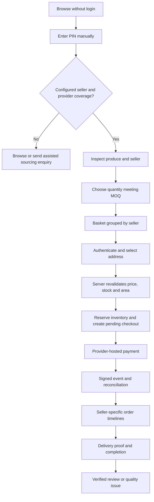
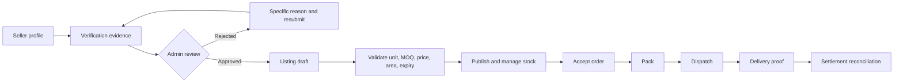

# KhetSetu journeys, screens and design system

This is the product-facing UX specification, revised for nationwide scope on 25 November 2026. The current hosted release is assisted sourcing; the full catalogue/checkout screens below describe the future transactional marketplace. Actual screen coverage and integration state are recorded in the repository delivery report.

## Current assisted experience

The public website accepts buyer requirements and farmer availability from across India. A manual Indian PIN field works without GPS; Mumbai `400008` is an example rather than a restriction. Keep the message beside submission: the team reviews sourcing and delivery feasibility before making a commitment.

Navigation covers buyer request, farmer supply, private request tracking, help/contact and the existing Operations sign-in. Tracking uses the device-held private receipt secret; a public reference grants no access. Operations retains its owner-only hosted identity checks. Nationwide intake must not add public admin access or weaken private tracking.

A formatted PIN is not verified carrier coverage. Distinguish request saved, reviewing, quoted, manually confirmed and fulfilled using the actual operational state. Do not describe a saved requirement as an order or payment. Use an honest unsupported/needs-review state when the team cannot serve a requested route, with contact/help available.

## Future marketplace navigation

Public: Home, Browse, Produce detail, Seller profile, How it works, Help and policies, Sign in. The header keeps location, search, language and basket easy to reach. Discovery is nationwide; real delivery eligibility is expressed for the selected PIN and seller, based on configured coverage.

Buyer application: Browse, Orders, Bulk requests, Account. Basket and checkout are contextual. Order details contain payment, seller-specific items, delivery timeline, support and permitted next actions. Messages, notifications and addresses live under account or the associated order.

Seller application: Overview, Listings/Inventory, Orders, RFQs, Payouts, Settings. The overview prioritises actions requiring attention before revenue charts. Each inventory change asks for a reason when it affects active orders.

Administration: Overview, Verification, Listings, Orders/Shipments, Payments/Refunds/Payouts, Disputes, Service areas/Fees, Content, Staff/Audit. Permission-denied views explain that an authorised colleague must perform the action without exposing restricted records.

## Future transactional journeys

Business buyer: describe produce, quantity, unit, grade, destination and needed date → submit RFQ → sellers quote total and fulfilment terms → compare like-for-like → accept an unexpired quotation → reserve and pay → use the same order lifecycle.

Support: select an owned order → choose damaged/spoiled, weight discrepancy, missing item or other reason → attach evidence and requested resolution → submit → operations inspect seller response and internal notes → authorised decision → provider refund if appropriate → recorded outcome. Internal notes are never shown as buyer/seller messages.

## Future marketplace screen inventory and required states

| Screen family | Primary action | Empty, error or restricted state |
| --- | --- | --- |
| Browse/search | Find available produce | No matches with clear filters; connection retry; cached prices marked as such |
| Detail | Select valid quantity | Expired/paused stock message; unavailable delivery; photo fallback |
| Basket | Review each seller total | Empty basket; quantity/price change requires review; out-of-area checkout blocked |
| Authentication | Request/verify OTP | Resend countdown; expired code; attempts limit; no provider configured |
| Checkout/payment | Confirm address and provider payment | Server conflict; pending/failed payment; safe retry using same checkout key |
| Orders/tracking | Understand status and next action | No orders; delayed delivery; payment awaiting confirmation; support action |
| RFQs/quotes | Compare and accept terms | No quotations; expired/withdrawn quote; inventory changed |
| Listing editor | Save draft/publish | Local draft restored; upload retry; validation near field; approval required |
| Seller fulfilment | Accept, pack or dispatch | Ownership denied; invalid transition; missing proof |
| Dispute/review | Submit evidence or review | Window unavailable with support route; duplicate submission; incomplete order |
| Admin review | Approve/reject with reason | Restricted role; record updated by colleague; mandatory decision reason |

All interactive actions need loading and disabled states to prevent accidental repetition. A toast supplements rather than replaces inline error information. Never hide a critical error only in a transient notification.

## Visual system

The visual direction is calm and practical: deep green navigation, clear produce photography, lime emphasis and restrained orange accents. Use generous white space, clear numerals and direct labels. Do not use decorative status dots or stock urgency claims without data.

| Token | Value | Use |
| --- | --- | --- |
| Forest | `#173f35` | Primary action, navigation, strong contrast |
| Leaf | `#d9ed95` | Selected state, soft emphasis with forest text |
| Harvest | `#f38b50` | Small accent, not body text on white |
| Surface | `#f6f7f2` | Page canvas |
| Ink | `#20342b` | Primary text |
| White | `#ffffff` | Cards and inputs |
| Type | DM Sans or Manrope; system fallback; Hindi-capable fallback | Body, headings, numeric data |
| Spacing | 4, 8, 12, 16, 24, 32, 48 px | Shared layout rhythm |
| Radius | 12 px controls, 18–24 px cards | Consistent reusable surfaces |

Use at least 16 px body text and 14 px regular labels; do not shrink task-critical totals or statuses. Touch targets are at least 44×44 px. Check actual contrast for text, focus and disabled states; a colour token alone is not proof of accessibility.

## Reusable components

- Location picker: formatted Indian PIN input, manual address and explicit intake-versus-delivery eligibility; optional one-time GPS with a clear purpose. Keep example PINs distinct from actual provider coverage.
- Produce card: title, variety, unit price, seller origin, available quantity/MOQ, grade, delivery eligibility and add/select action.
- Quantity stepper: labelled control with minimum/maximum, valid increments and typed entry.
- Seller badge: exact verification meaning; no broad quality guarantee from identity verification alone.
- Money breakdown: subtotal, delivery, buyer/platform fee, tax if applicable, discount and final payable total.
- Order group: one seller, immutable line snapshots, separate fulfilment/payment/refund attribution.
- Timeline: status label, business-local display time, actor-visible explanation and proof link when authorised.
- Decision dialog: action, consequence, reason and final confirmation for irreversible operational decisions.
- Evidence uploader: file restrictions, compression, scan status, progress, retry and private access.

## Future marketplace responsive and native behaviour

On mobile, use a single content column, sticky order/basket summary only when it does not cover content, and short forms with progressive disclosure. On desktop, use filters beside the results and a readable admin table with keyboard-accessible actions. Convert dense tables to labelled cards on narrow screens.

The native app uses React Native primitives and shared API contracts. It must not embed the website as a WebView. Persist basket and listing drafts locally; distinguish saved-on-device from submitted-to-server. Queue only operations designed for idempotent retries; do not queue payment success or irreversible decisions offline.

Translation keys must cover labels, validation, status descriptions and accessibility announcements. Preserve user-entered product names and evidence. Format INR and dates with locale-aware formatters. Hindi layouts must be reviewed on real devices for wrapping and fallback fonts.

## Accessibility and low-bandwidth review

Keyboard completion, visible focus, correctly associated labels, semantic headings, screen-reader names, dialog focus return, error summaries and reduced-motion behaviour are release checks. Do not rely on colour alone. Native controls need accessibility labels and logical reading order.

Serve responsive compressed imagery with dimensions and lazy loading below the fold. Avoid autoplay media and heavy animations. Keep previous search results visible during refresh. A slow connection should produce a recoverable pending state, not an empty screen or a second order.
